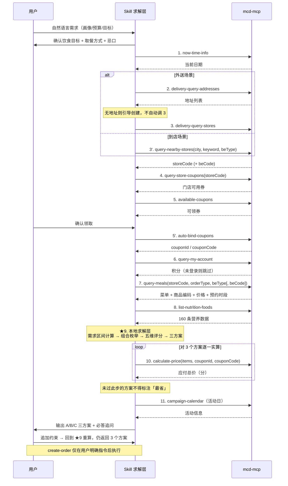

# MCP 集成说明

本 Skill 的全部实时数据来自麦当劳官方 MCP Server（`mcd-mcp`），本地仅承担
营养换算与多方案求解，不缓存门店价格与优惠券。

---

## 一、Server 配置

配置文件：`mcp-config.example.json`

```json
{
  "mcpServers": {
    "mcd-mcp": {
      "type": "streamablehttp",
      "url": "https://mcd.mcd.cn",
      "headers": {
        "Authorization": "Bearer ${MCD_MCP_TOKEN}"
      }
    }
  }
}
```

**Token 处理原则**：仓库内只保留 `${MCD_MCP_TOKEN}` 占位符。
真实 Token 通过环境变量注入，绝不提交到版本库、绝不写入文档或对话记录。

在 WorkBuddy 中安装：连接器管理页 → 右上角自定义连接器入口 → 信任该 Server。

---

## 二、使用的 12 个工具

| # | 工具名 | 作用 | 在本 Skill 中的职责 |
|---|---|---|---|
| 1 | `now-time-info` | 获取当前完整时间信息 | 确定当前日期，供 `campaign-calendar` 判断是否活动日。不猜日期 |
| 2 | `delivery-query-addresses` | 查询用户外送地址 | 外送场景前置校验。无地址时引导创建，不自动创建 |
| 3 | `delivery-query-stores` | 查询地址可配送门店 | 外送场景门店来源，本身即按地址计算，返回 `storeCode` + `beCode` |
| 4 | `query-nearby-stores` | 查询附近到店门店 | 到店场景门店来源。参数仅 `searchType` / `city` / `keyword` / `beType` |
| 5 | `query-store-coupons` | 查询门店可用券 | **「省」的核心数据源**，决定哪些券可用于叠加 |
| 6 | `available-coupons` | 查询可领取券 | 列出可领券，用户确认后引导领取 |
| 7 | `auto-bind-coupons` | 一键领取优惠券 | 拿到 `couponId` / `couponCode`，`calculate-price` 的必要输入 |
| 8 | `query-my-account` | 查询账户信息与积分 | 判断是否可用积分抵扣。未登录时跳过并说明 |
| 9 | `query-meals` | 查询门店菜单 | 返回餐品、商品编码、价格。`reservation=true` 时记录 `reservationTimeOptions` |
| 10 | `list-nutrition-foods` | 160 条餐品营养成分 | 按 `productName` 与菜单匹配，提供能量/蛋白/脂肪/碳水/钠/钙 |
| 11 | `calculate-price` | 计算商品价格（含优惠） | **真实验价**。商品金额 + 配送费 − 优惠 = 应付总价。返回单位为分，展示需除以 100 |
| 12 | `campaign-calendar` | 查询活动日历 | 活动日叠加活动信息 |

**辅助工具**：`delivery-create-address`（创建地址）**不被自动调用**，
仅在用户明确要求时由用户自行触发。

---

## 三、调用时序



---

## 四、业务价值：解决了什么人工决策难以完成的问题

### 1. 多目标耦合，人脑无法同时权衡

一次点餐实际要同时满足五个互相冲突的目标：预算上限、蛋白质密度、
热量贴合、钠摄入、钙贡献。人工决策时，人只能串行处理 —— 先看价格，
再凭印象估热量，最后忘记钠和钙。`SolveEngine` 把五维归一化后加权成单一分数，
一次遍历数百个候选组合，输出帕累托意义上的多个非支配解。

### 2. 「最省」在叠加券后是算不出来的

门店标价、可领券、券使用门槛、可用积分、配送费，这五项在人工核对时
极易漏项，尤其在移动端点单界面往往要多次跳转才能看全。`query-store-coupons`
+ `available-coupons` + `query-my-account` + `calculate-price` 的链路，
把「省」从估算变成实算。

### 3. 营养标示是「每份」数据，与「我该吃多少」之间存在换算鸿沟

门店标示的是每份营养值，用户需要的是自己这一餐该吃到什么区间。
`nutrition_needs.py` 完成了 Mifflin-St Jeor → PAL → TDEE → 单餐区间
→ 与套餐营养值的对比这五步换算，并按 2023 版 DRIs 查表处理钙（分段不同）、
对钠只做上限告警。这套换算手工做一次约需 10 分钟，且极易用错旧版数值。

### 4. 缺失信息需要被显式暴露，而不是静默忽略

营养库有部分条目无对应数据。若静默跳过，用户会误以为方案营养已完整考虑。
本 Skill 将这些餐品单独列出并说明原因；`nutritionDescription` 字段中
混有能量换算说明（如「纯悦」→「能量约清水1杯」），一律原样保留展示，
不做「脏数据清洗」。

---

## 五、为什么 `calculate-price` 真实验证这一步是必要的

**核心原因：门店标价不是应付金额。**

`query-meals` 返回的是**标价**。用户实际支付的金额还取决于至少四个变量：

| 变量 | 来源工具 | 人工核对的难点 |
|---|---|---|
| 优惠券抵扣 | `query-store-coupons` / `auto-bind-coupons` | 券有使用门槛、适用门店、可用时段，需逐张核对 |
| 可领取未领取的券 | `available-coupons` | 用户往往不知道自己「能领」而未领，漏掉就是真金白银 |
| 积分抵扣 | `query-my-account` | 积分规则与可抵扣比例不在菜单页展示 |
| 配送费 | 外送场景随地址变化 | 自提免配送费，与外送可能差出一份小食的钱 |

**因此，「极致省钱」这个结论如果建立在标价之上，是一个可能方向性错误的结论。**
标价最低的组合，叠加可用券后未必实付最低；而标价稍高但可用大额券的组合，
实付反而更低。只有 `calculate-price` 能给出这个答案。

**工程上的强制约束（本 Skill 的铁律之一）**：

1. 求解引擎的 `Combo._price_verified` 字段默认 `False`。
2. 只有拿到 `calculate-price` 返回值并写入 `priced` 字典后，
   方案才会被标记 `verified=True`。
3. `render()` 输出的 `price.note` 会如实区分两种状态：
   - `已通过 calculate-price 实算确认`
   - `未经 calculate-price 实算验证，仅为标价参考`
4. 未验证的方案**不得**以「最省」「最划算」等结论性措辞呈现。

这个设计保证了：即使 MCP 调用失败、限流、或用户中途打断，
Skill 也不会把一个未经验证的猜测包装成结论交给用户。

---

## 六、价格单位注意事项

`calculate-price` 返回的价格字段单位为**分**，展示给用户前必须除以 100 转为元。
`query-meals` 的价格字段需按同一规则确认后再录入求解引擎，否则组合总价会放大 100 倍，
导致所有候选都被预算约束过滤掉、求解结果为空。